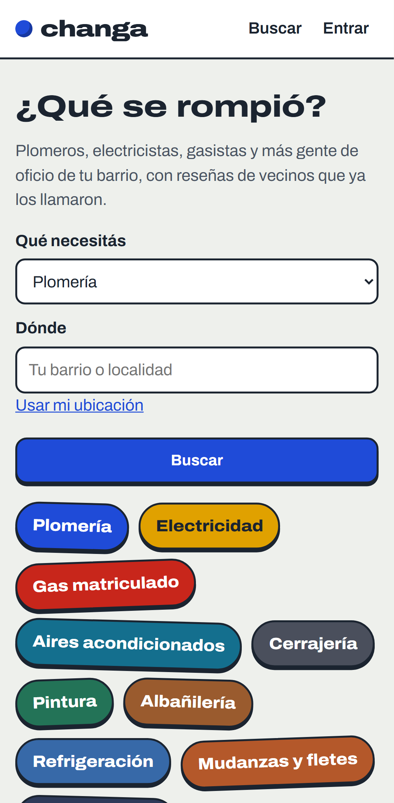
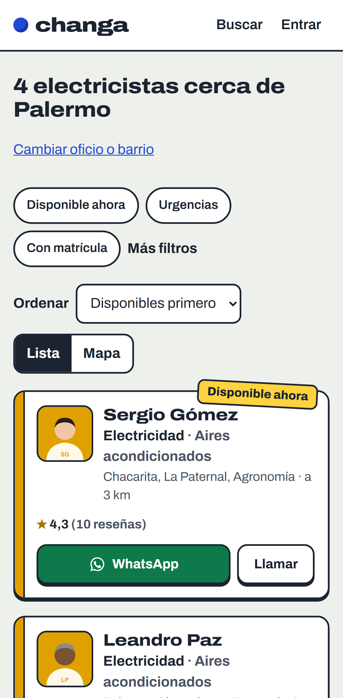
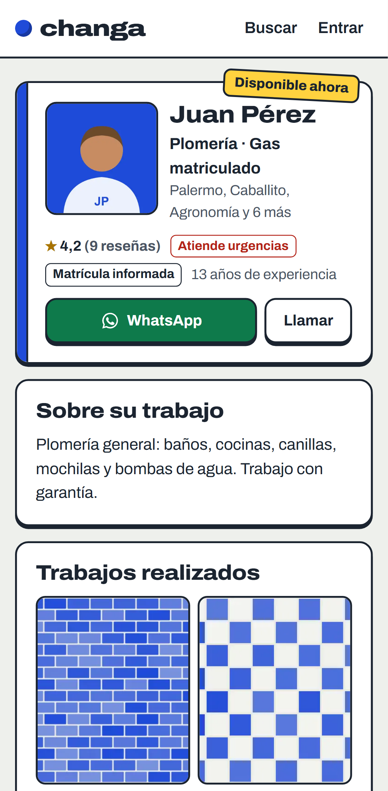
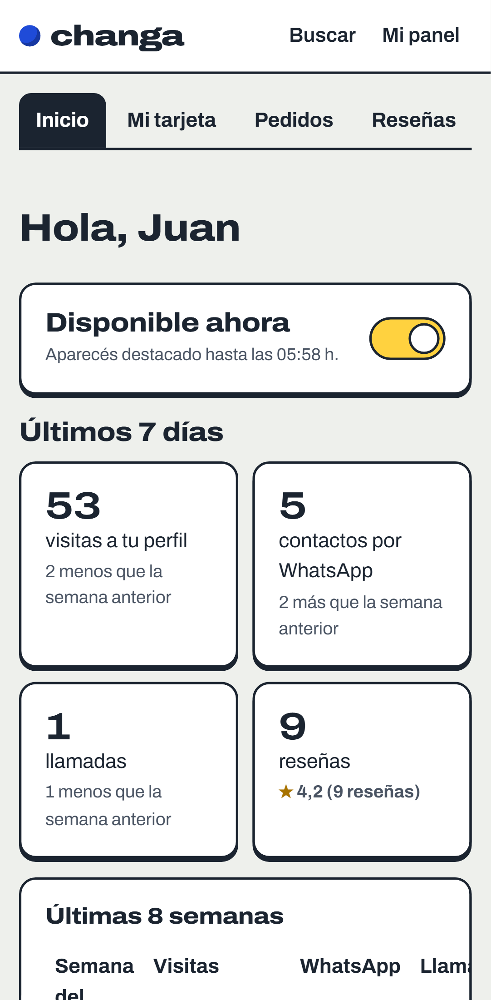
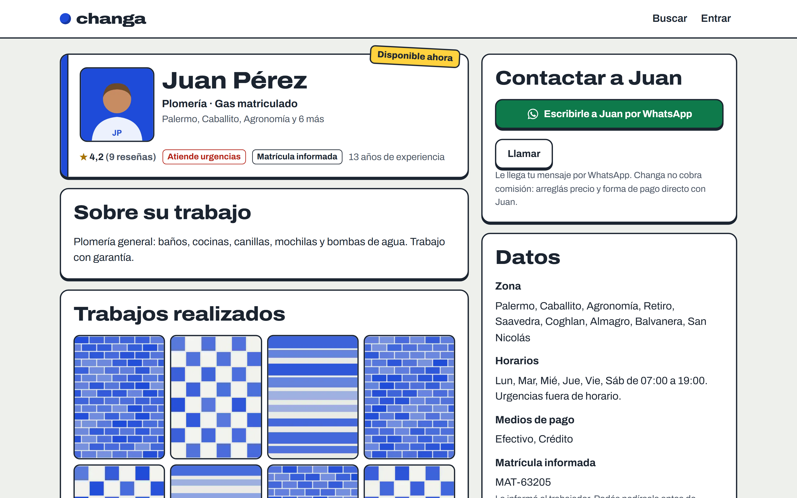

# Changa · el directorio de oficios de tu barrio

En Argentina, conseguir un plomero, electricista o gasista de confianza depende del boca en boca o de grupos de WhatsApp. Y mucha gente de oficio no tiene dónde mostrarse más allá de su cuadra. **Changa** conecta a las dos partes: cada trabajador publica su oficio, su zona y su número; quien necesita un servicio lo encuentra, lee reseñas de vecinos que de verdad lo contactaron y le escribe por WhatsApp en segundos.

**Demo:** https://changa-kappa.vercel.app · entrá con `juan@changa.test` (trabajador), `cliente@changa.test` (clienta) o `admin@changa.test` (moderación): en la demo el enlace de ingreso aparece en pantalla.

| Portada | Resultados | Perfil | Panel |
|---|---|---|---|
|  |  |  |  |



## Qué hace

**Clientes (sin cuenta):** buscan por oficio y barrio, o usan su ubicación; ven los resultados en lista o mapa; filtran por "disponible ahora", urgencias, matrícula, calificación y medios de pago; tocan "WhatsApp" y se abre el chat con un mensaje ya armado ("Hola Juan, te encontré en Changa. Necesito un plomero en Palermo para…"). También pueden pedir presupuesto a hasta 3 trabajadores a la vez, con fotos.

**Trabajadores:** entran con enlace mágico o Google, verifican su celular y arman su tarjeta (oficios, barrios o radio en km, horarios, urgencias, medios de pago, matrícula, hasta 8 fotos). En el panel tienen el interruptor "Disponible ahora" (se apaga solo a las 8 horas), visitas y contactos por semana, los pedidos de presupuesto, sus reseñas para responder en público, su link propio (`changa.app/juan-plomero`), un QR y una hoja de tarjetas tamaño imán para imprimir.

**Reseñas confiables:** solo reseña quien contactó desde Changa, entre 1 y 60 días después, una vez por trabajador. El trabajador responde y puede denunciar, pero no borrar.

**Moderación:** denuncias de perfiles y reseñas, y un panel para ocultarlas o descartarlas.

## Diseño

La idea viene del imán de heladera con el número del plomero y la tarjeta que te dejan en el buzón.

- **Paleta:** fondo gris "esmalte de heladera" (`#EEF0EC`), tinta azul-negra de imprenta (`#1B2430`) y azul cobalto (`#1F4BD8`), el color clásico de los imanes impresos. Amarillo resaltador (`#FFD23F`) solo para "Disponible ahora" y verde oscuro (`#0E7A4B`) solo para WhatsApp, con contraste AA para texto blanco. Cada oficio tiene su color: es la franja de la tarjeta y el imán de la portada.
- **Tipografía:** [Archivo](https://fonts.google.com/specimen/Archivo), de Omnibus-Type, una fundidora de Buenos Aires. Su eje de ancho da los titulares expandidos de tarjeta de imprenta y el texto normal para leer, con una sola familia (una sola descarga).
- **La tarjeta-imán** es la pieza central: borde grueso, sombra dura como un imán con espesor, franja del color del oficio y un sticker amarillo apenas torcido para "Disponible ahora". Todo lo demás es sobrio a propósito.
- Los estados vacíos y los errores dicen qué pasó y qué hacer ("Probá sacando algún filtro", "Escribilo con código de área, por ejemplo 11 2345-6789").

## Decisiones técnicas

| Decisión | Por qué |
|---|---|
| **Next.js 16 (App Router) + TypeScript** | Perfiles y páginas por oficio/zona renderizados en el servidor, así Google los indexa. Formularios con server actions. |
| **Postgres sin PostGIS** (haversine en SQL) | Para miles de trabajadores en el GBA alcanza y sobra. Funciona igual en Neon, Supabase y PGlite, sin depender de una extensión. Si un día hace falta, se migra a `geography` sin tocar la interfaz. |
| **PGlite en local** | Postgres real compilado a WebAssembly: `git clone` + `npm i` y anda, sin Docker. Las pruebas de búsqueda corren contra Postgres de verdad, en memoria. |
| **Drizzle + Zod** | SQL tipado y validación en cada borde (formularios, URL, uploads). Los parámetros inválidos de la URL se ignoran en vez de romper la página. |
| **Autenticación propia** (~150 líneas + `arctic` para Google) | Enlace mágico con token aleatorio guardado hasheado, que vence a los 15 minutos y se confirma con un botón (los antivirus de mail que "abren" links no lo consumen). Sesiones en cookies httpOnly. |
| **El teléfono nunca está en el HTML** | WhatsApp es un POST que redirige a `wa.me`; "Llamar" pide el número al tocarlo. Ambos con límite por IP. |
| **Límites de uso en Postgres** | Ventana fija por IP hasheada: funciona igual con una o cien instancias serverless, sin Redis. Además hay un límite general en el proxy, alto a propósito porque muchas líneas móviles comparten IP (CGNAT). |
| **Imágenes** | `sharp` endereza, borra metadatos (incluido el GPS), achica a WebP de 1200 px + miniatura de 400 px. Se sirven con caché inmutable. Se guardan en Postgres (unos 60 KB cada una): entra en el plan gratis y se pasa a R2/Blob cambiando un archivo. |
| **Mapa con Leaflet + OpenStreetMap** | Se carga solo al abrir la vista de mapa. Las ubicaciones se redondean a ~1 km. |
| **Turnstile** en ingreso, presupuestos y denuncias | Se activa al configurar las claves; sin ellas (desarrollo) no aparece. |
| **Nada de "pagar para aparecer"** | Orden por disponibilidad, cercanía o calificación (promedio bayesiano, para que 1 reseña de 5 no le gane a 40 de 4,8). |

El modelo de datos (`src/db/schema.ts`) deja lugar para pagos (colgando de `quote_requests`) y chat (colgando de `contacts`) sin romper lo actual. `PLAN.md` tiene las preguntas abiertas del pedido original y qué decidí en cada una.

## Pruebas

```bash
npm test
```

```bash
npm run build && npm run test:e2e
```

- **40 unitarias** (Vitest): normalización de teléfonos, mensaje de WhatsApp, reglas de reseñas, búsqueda y filtros contra Postgres real en memoria, estadísticas semanales con la zona horaria argentina.
- **27 de punta a punta** (Playwright, celular, sobre el build de producción): registrarse y publicar el perfil; buscar, contactar por WhatsApp y llamar; reseñar y las reglas de quién puede; responder reseñas; pedir presupuesto; panel, link propio y QR; borrar la cuenta; denunciar y moderar; SEO (sitemap, robots, datos estructurados).
- **Accesibilidad:** axe (WCAG 2.2 AA) en todas las pantallas principales y una prueba de uso solo con teclado.
- **Rendimiento:** presupuesto de bytes transferidos: la portada pesa ~270 KB y el perfil ~305 KB, y el mapa no se descarga si no se pide.

Las capturas del README se regeneran con `CAPTURAS=1 npx playwright test capturas`.

## Correrlo localmente

Requisitos: Node 20.9 o más nuevo.

```bash
npm install
```

```bash
npm run db:seed
```

```bash
npm run dev
```

Abrí http://localhost:3000. La semilla carga 60 trabajadores ficticios en CABA y el GBA, con reseñas y estadísticas. Sin proveedores configurados, la app corre en **modo demo**: el enlace mágico y el código SMS aparecen en pantalla.

Cuentas de prueba: `juan@changa.test` (trabajador, perfil `/juan-plomero`), `cliente@changa.test` (clienta que puede reseñar a Juan), `admin@changa.test` (moderación).

> La base local vive en `.data/pglite` y PGlite admite un solo proceso: no corras `dev` y `db:seed` a la vez. Si la base queda dañada por un corte brusco, `npm run db:seed` la regenera.

## Despliegue (Vercel + Neon, gratis)

1. **Base de datos:** creá un proyecto en [neon.tech](https://neon.tech) (plan Free) y copiá la *connection string* con pooling (`postgres://…-pooler…/neondb?sslmode=require`).
2. **Migraciones y datos de ejemplo**, desde tu compu (en Windows PowerShell: `$env:DATABASE_URL="postgres://…"` antes de cada comando):
   ```bash
   DATABASE_URL="postgres://…" npm run db:migrate
   ```
   ```bash
   DATABASE_URL="postgres://…" npm run db:seed
   ```
3. **Subí el repo a GitHub** e importalo en [vercel.com/new](https://vercel.com/new). El framework se detecta solo.
4. **Variables de entorno en Vercel** (ver `.env.example`):
   - `DATABASE_URL`: la de Neon.
   - `NEXT_PUBLIC_SITE_URL`: la URL final, por ejemplo `https://changa.vercel.app`.
   - `AUTH_SECRET`: un texto aleatorio largo.
   - Para una demo de portfolio sin mail ni SMS: `DEMO_MODE=1`. **Cualquiera puede entrar con cualquier email**, así que usalo solo con los datos ficticios.
   - Para usuarios reales: `RESEND_API_KEY` y `EMAIL_FROM` (mail), `GOOGLE_CLIENT_ID` y `GOOGLE_CLIENT_SECRET` (redirect: `{URL}/auth/google/callback`), `TWILIO_*` (SMS) y las claves de Turnstile. Sacá `DEMO_MODE`.
5. **Deploy.** Después, en Vercel → Firewall, sumá una regla de rate limit: el límite del proxy es por instancia.

La integración continua (`.github/workflows/ci.yml`) corre tipos, lint, unitarias, build y e2e en cada push.

## Pendiente / límites conocidos

- **La demo corre en modo demo:** sin mail, SMS, Google ni Turnstile configurados.
- **El SMS cuesta plata** (Twilio). Una alternativa gratis a evaluar: verificar pidiendo que el trabajador mande un WhatsApp a un número de Changa.
- **Matrícula:** se muestra como "informada". No se valida contra los entes (Enargas, colegios).
- **Avisos al trabajador:** los pedidos de presupuesto aparecen en el panel, sin mail ni push.
- **Sin Content-Security-Policy:** hay headers de seguridad básicos, pero falta una CSP con nonces (Next, Turnstile y las teselas del mapa la complican).
- **Las imágenes se sirven a quien tenga el id** (UUID aleatorio, no adivinable), también las de pedidos de presupuesto.
- **Fotos de la semilla:** son ilustraciones generadas, no fotos de personas reales.
